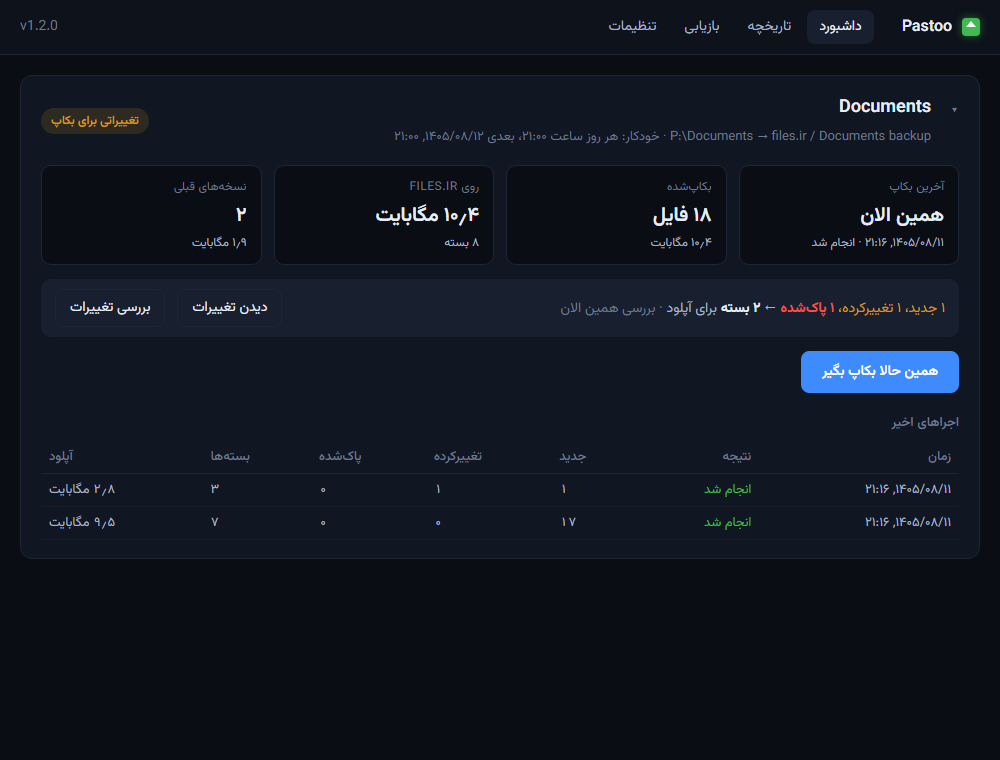
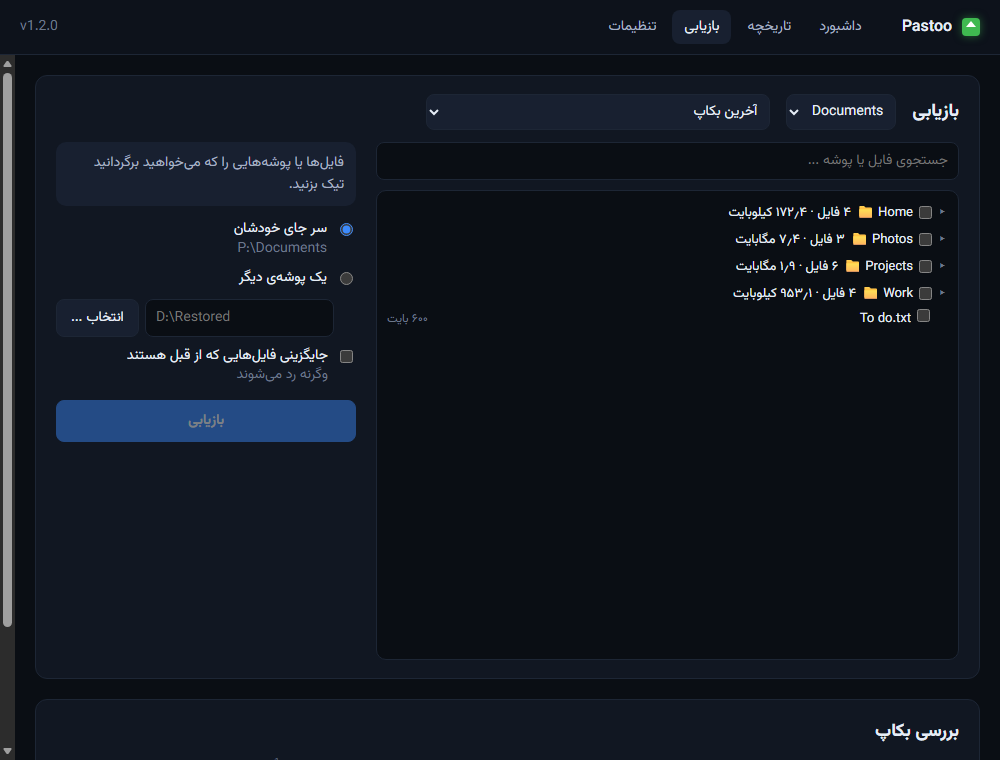
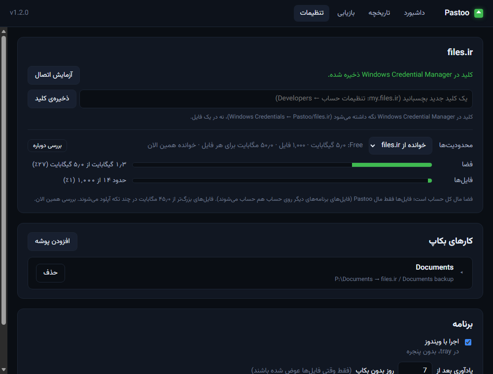

# Pastoo (پستو)

[English](README.md) · **فارسی**

بکاپ افزایشی پوشه‌های شما روی حساب [files.ir](https://my.files.ir) خودتان، برای ویندوز.

*پستو* اتاقک کوچک پشت خانه‌های قدیمی بود که چیزهای باارزش را آن‌جا نگه می‌داشتند.

بکاپ اول همه‌چیز را آپلود می‌کند؛ از آن به بعد فقط چیزی که عوض شده بالا می‌رود. فایل‌های
کوچک در **بسته‌های zip** فرستاده می‌شوند، برای همین بکاپ هزاران فایل با چند ده آپلود انجام
می‌شود، نه هزاران آپلود. بسته‌هایی که جایگزین می‌شوند به‌عنوان نسخه‌ی قبلی نگه داشته می‌شوند و
هر فایلی را می‌شود برگرداند - روی همین کامپیوتر یا هر کامپیوتر دیگری.

> Pastoo یک برنامه‌ی مستقل و غیررسمی است و ساخته‌ی files.ir یا وابسته به آن نیست؛ از API
> توسعه‌دهندگان files.ir با کلید API خود شما استفاده می‌کند.



## امکانات

- **افزایشی**: checksum هر فایل به خاطر سپرده می‌شود؛ فقط بسته‌هایی دوباره آپلود می‌شوند که
  فایلی از آن‌ها عوض شده. تغییر حتی وقتی دیده می‌شود که برنامه‌ای بعد از نوشتن، تاریخ فایل را
  برمی‌گرداند (مثل VeraCrypt با کانتینرهایش) - بدون هیچ تنظیمی.
- **فایل‌های در حال استفاده امن‌اند**: فایلی که برنامه‌ی دیگری در حال نوشتن روی آن است (کانتینر
  mount‌شده‌ی VeraCrypt، فایل `.pst` باز Outlook) هیچ‌وقت نیمه‌کاره خوانده نمی‌شود و «پاک‌شده»
  هم حساب نمی‌شود: آخرین نسخه‌ی بکاپ‌شده‌اش می‌ماند و به شما گفته می‌شود که ببندیدش.
- **بسته‌ها**: فایل‌های هر پوشه‌ی تا ۱۰ مگ یک zip می‌شوند، پوشه‌های بزرگ‌تر تقسیم می‌شوند و
  فایل‌های ۵ مگ و بیشتر جدا آپلود می‌شوند. خیلی سریع‌تر از آپلود فایل‌به‌فایل، و با بار کمتر روی
  سرورهای files.ir.
- **نسخه‌های قبلی**: بسته‌ی جایگزین‌شده به `_versions` می‌رود و ۵ نسخه و دست‌کم ۳۰ روز نگه داشته
  می‌شود (هر دو قابل تنظیم).
- **پیش‌نمایش**: قبل از بکاپ می‌بینید چه چیزی جدید، تغییرکرده یا پاک‌شده است؛ فایل‌های پاک‌شده
  قرمزند و بکاپی که فایلی را پاک می‌کند همیشه اول فهرست را نشان می‌دهد.
- **بازیابی**: فایل‌ها یا پوشه‌ها را از آخرین بکاپ یا یک نسخه‌ی قبلی تیک بزنید و به جای خودشان
  یا یک پوشه‌ی دیگر برگردانید.
- **بررسی بکاپ**: بسته‌ها را دانلود می‌کند و هر فایل را با checksum آن مقایسه می‌کند.
- **بکاپ خودکار (اختیاری)**: هر روز سر یک ساعت یا هر چند ساعت، وقتی Pastoo در tray در
  حال اجراست؛ اگر کامپیوتر سر ساعت خاموش بوده، بعد از ورود به ویندوز جبران می‌شود.
- **محافظ پاک شدن گسترده**: بکاپ خودکاری که بخواهد فایل‌های زیادی را پاک کند (۱۰۰ فایل، یا
  یک پنجم آن‌ها) یا نصف فایل‌ها را یک‌جا عوض کند، اول منتظر نگاه شما می‌ماند: پوشه‌ای که
  اشتباهی خالی شده، باج‌افزار یا یک کلیک اشتباه به بکاپ نمی‌رسد. فایل جابه‌جاشده پاک‌شده حساب
  نمی‌شود، و پوشه‌ای که درایوش وصل نیست هیچ‌وقت به‌عنوان «همه پاک‌شده» بکاپ گرفته نمی‌شود.
- **چند کار بکاپ**: هر کدام با پوشه‌ی خودش، پوشه‌اش روی files.ir و قواعد رد کردن، همراه با
  شمارش زنده‌ی آنچه بکاپ خواهد شد.
- **آشنا با پلن‌های files.ir**: محدودیت‌های پلن شما (فضا، تعداد فایل، بزرگ‌ترین آپلود) را می‌خواند
  و پر بودن حساب را نشان می‌دهد؛ فایل‌های بزرگ‌تر از سقف یک آپلود در چند تکه فرستاده می‌شوند.
- **آیکون tray**: سبز، زرد (مدتی بکاپ نشده، یا یک بکاپ خودکار منتظر شماست)، قرمز (آخرین بکاپ
  ناموفق بوده) یا آبی (در حال بکاپ)؛ و یادآوری وقتی چند روز بکاپ نگرفته‌اید و فایل‌ها عوض شده‌اند.
- **فارسی یا انگلیسی**: پنجره، tray و اعلان‌ها؛ فارسی راست‌به‌چپ، با تاریخ شمسی و عدد فارسی
  (تنظیمات ← برنامه ← زبان؛ پیش‌فرض مثل ویندوز).
- **وابسته به برنامه نیستید**: بسته‌ها zip معمولی‌اند و `_index.txt` می‌گوید هر فایل در کدام zip
  است: بدون Pastoo هم می‌شود zip را از سایت دانلود کرد و باز کرد.
- کلید شما در Windows Credential Manager می‌ماند؛ هیچ چیزی جز به files.ir فرستاده نمی‌شود.



## نصب

از بخش [Releases](https://github.com/sadi754/pastoo/releases) دانلود کنید:

- **`Pastoo-Setup-<version>.exe`**: فقط برای کاربر شما نصب می‌شود (بدون نیاز به ادمین)، در
  `%LOCALAPPDATA%\Programs\Pastoo`، با میانبر در منوی Start و برنامه‌ی حذف.
- **`Pastoo-<version>-win64.zip`**: نسخه‌ی قابل‌حمل: هر جا خواستید از zip بیرون بیاورید و
  `Pastoo\Pastoo.exe` را اجرا کنید.

ویندوز ۱۰ یا ۱۱، ۶۴ بیتی، با Edge WebView2 (در ویندوز ۱۱ از قبل نصب است). برنامه امضای
دیجیتال ندارد، برای همین بار اول ممکن است SmartScreen بگوید «Windows protected your PC»:
**More info ← Run anyway**.

## شروع کار

1. در [my.files.ir](https://my.files.ir): تنظیمات حساب ← **Developers** ← یک کلید API بسازید
   (با دسترسی‌های `files.*`).
2. در Pastoo: **تنظیمات ← files.ir**، کلید را بچسبانید و **ذخیره‌ی کلید** را بزنید. کلید اول با
   files.ir بررسی می‌شود.
3. **تنظیمات ← کارهای بکاپ ← افزودن پوشه**: پوشه، اسم پوشه‌اش روی files.ir و چیزهایی که باید
   رد شوند را انتخاب کنید (**+ افزودن موارد رایج** پوشه‌های build و cache رایج و فایل‌های موقت را
   اضافه می‌کند). عددهای زیر قواعد نشان می‌دهند چه چیزی بکاپ خواهد شد.
4. **داشبورد ← همین حالا بکاپ بگیر.**



## استفاده

- **آیکون tray**: کلیک چپ پنجره را باز می‌کند، کلیک راست ← **همین حالا بکاپ بگیر**.
- **داشبورد**: یک کارت برای هر کار (با کلیک روی عنوانش جمع می‌شود): آخرین بکاپ، آنچه روی
  files.ir است و آنچه از آن موقع عوض شده؛ **دیدن تغییرات** فهرست فایل‌به‌فایل را نشان می‌دهد.
- **تاریخچه**: همه‌ی بکاپ‌ها، و این‌که هر کدام چه فایل‌هایی را اضافه، عوض یا پاک کرده.
- **بازیابی**: از آخرین بکاپ یا یک نسخه‌ی قبلی. فایل‌هایی که از قبل هستند رد می‌شوند، مگر
  *جایگزینی* را تیک بزنید. **بررسی بکاپ** ۵ بسته‌ی تصادفی یا همه را بررسی می‌کند.
- **تنظیمات**: کارها و قواعد رد کردن، اندازه‌ی بسته، مدت نگهداری نسخه‌های قبلی، بکاپ خودکار،
  محدودیت‌های پلن (خوانده از files.ir یا دستی)، اجرا با ویندوز، یادآوری و زبان.

در هر لحظه فقط یک بکاپ، بازیابی یا بررسی اجرا می‌شود - بین اپ و خط فرمان هم.

## چطور کار می‌کند

هر بکاپ پوشه‌ی کار را می‌گردد و هر فایل را با آنچه دفعه‌ی قبل آپلود شده مقایسه می‌کند.
فایل‌ها بر اساس پوشه در بسته‌ها دسته می‌شوند؛ بسته‌ای که هیچ فایلش عوض نشده دست نمی‌خورد،
بسته‌ی تغییرکرده به‌صورت zip جدید آپلود می‌شود و zip قبلی به `_versions` می‌رود. فایلی که روی
کامپیوتر پاک شده از نسخه‌ی بعدی بسته‌اش بیرون می‌رود - نسخه‌ی قبلی هنوز آن را دارد.

**دیدن تغییرات.** فایل وقتی دوباره خوانده می‌شود (و SHA-1 آن مقایسه می‌شود) که اندازه، تاریخ یا
شماره‌اش در change journal سیستم فایل NTFS (USN) عوض شده باشد. این شماره با هر نوشتنی جلو
می‌رود و نمی‌شود برش گرداند، برای همین کانتینری که VeraCrypt تاریخش را برمی‌گرداند هم دیده
می‌شود. درایوهای بدون journal (FAT، exFAT، درایو شبکه) به اندازه و تاریخ بسنده می‌کنند و هر فایلی
آن‌جا دست‌کم هفته‌ای یک بار دوباره خوانده می‌شود.

**بکاپ خودکار.** داخل خود Pastoo انجام می‌شود، پس فقط وقتی در tray در حال اجراست - با «اجرا با
ویندوز» یعنی هر وقت وارد ویندوز شده‌اید (اگر خاموش باشد تنظیمات هشدار می‌دهد، و «خروج» اول
می‌پرسد). زودتر از چند دقیقه بعد از ورود شروع نمی‌شود، و بکاپ خودکاری که کاری برای انجام پیدا
نکند به تاریخچه اضافه نمی‌شود. اگر بخواهد دست‌کم ۱۰۰ فایل یا یک پنجم فایل‌ها (دست‌کم ۱۰) را پاک
کند، یا نصف فایل‌ها (دست‌کم ۵۰) را یک‌جا عوض کند، چیزی آپلود نمی‌کند: آیکون tray زرد می‌شود، یک
اعلان دلیلش را می‌گوید، و بعد از اینکه تغییرات را دیدید و «همین حالا بکاپ بگیر» را زدید، بکاپ
انجام می‌شود. فایل پاک‌شده‌ای که محتوایش با اسم دیگری هنوز در پوشه هست فقط جابه‌جا شده و حساب
نمی‌شود.

**فایل‌های در حال استفاده.** فایل‌ها فقط وقتی خوانده می‌شوند که هیچ برنامه‌ی دیگری در حال نوشتن
روی آن‌ها نباشد. فایلی که در حال استفاده است آخرین نسخه‌ی بکاپ‌شده‌اش را نگه می‌دارد؛ اگر
فایل‌های دیگر بسته‌اش عوض شده باشند، آن بسته برای بکاپ بعدی صبر می‌کند. فایلی که همیشه باز
است (دیتابیس برنامه‌ای که دائم در حال اجراست) فقط وقتی بسته شود بکاپ گرفته می‌شود. کانتینر
VeraCrypt را بهتر است وقتی dismount است بکاپ بگیرید.

روی files.ir، هر کار پوشه‌ی خودش را دارد:

```
<job's folder>/
  _backup.json          همه‌چیز درباره‌ی بکاپ (فایل‌ها، بسته‌ها، نسخه‌ها) - با آن کامپیوتر
                        دیگری هم می‌تواند بکاپ را ادامه دهد یا بازیابی کند
  _index.txt            هر فایل و بسته‌ای که در آن است (برای خواندن خودتان)
  _changes/<date>.txt   تغییرات هر بکاپ (۵۰ تای آخر؛ تاریخچه در اپ همه را نگه می‌دارد)
  _versions/<date>/     بسته‌هایی که در آن بکاپ جایگزین شدند
  <folders>/...zip      بسته‌ها؛ فایل‌های ۵ مگ و بیشتر جدا آپلود می‌شوند
  <name>.parts/         فایلی بزرگ‌تر از سقف یک آپلود (در پلن رایگان ۵۰ مگ)، در تکه‌های
                        part001، part002 ... - بازیابی دوباره به هم وصلشان می‌کند
```

**پلن‌های files.ir.** Pastoo در هر اجرا و بعد از هر بکاپ پلن حساب را می‌خواند، پس ارتقای پلن
خودش تشخیص داده می‌شود (پلن رایگان: ۵ گیگ، ۱۰۰۰ فایل، ۵۰ مگ برای هر فایل). از ۷۰٪ پر بودن،
همه‌ی صفحه‌ها هشدار نشان می‌دهند. نسخه‌های قدیمی `_index.txt` و `_backup.json` به جای سطل زباله
برای همیشه پاک می‌شوند، چون سطل زباله هم از فضا کم می‌کند.

**رمزنگاری نمی‌شود.** بسته‌ها zip معمولی‌اند و هر کسی که به حساب files.ir دسترسی داشته باشد
می‌تواند بخواندشان - همین است که آن‌ها را بدون Pastoo هم قابل‌استفاده می‌کند.

## خط فرمان

`pastoo-cli.exe` (کنار `Pastoo.exe`)، مثلاً برای Task Scheduler:

```
pastoo-cli run [--job ID] [--dry-run]          بکاپ (--dry-run: فقط تغییرات را نشان بده)
pastoo-cli restore PATH... --to FOLDER [--overwrite] [--dry-run]
pastoo-cli history [--job ID]
pastoo-cli jobs
```

## چه چیزی کجاست

- `%LOCALAPPDATA%\Pastoo`: `settings.json` (کارها و تنظیمات)، `state.db` (آنچه روی files.ir
  است و تاریخچه)، `backup.log` (خط‌های هر بکاپ)، `app.log`.
- کلید files.ir: Windows Credential Manager ← Windows Credentials ← `Pastoo/files.ir`.
- *اجرا با ویندوز*: `HKCU\Software\Microsoft\Windows\CurrentVersion\Run`، با اسم «Pastoo».

**حذف برنامه** از Settings ویندوز ← Apps. می‌پرسد داده‌های `%LOCALAPPDATA%\Pastoo` هم پاک شوند
یا نه؛ بکاپ‌های شما روی files.ir در هر حال می‌مانند. کلید تا وقتی خودتان از Credential Manager
پاکش نکنید می‌ماند.

## ساخت از روی سورس

Python 3.10 یا جدیدتر (توسعه با 3.12)، ویندوز.

- `run.bat`: اجرای اپ (بار اول یک `.venv` اختصاصی می‌سازد).
- `backup.bat`: یک بکاپ از خط فرمان (موتور بکاپ فقط از کتابخانه‌ی خود Python استفاده می‌کند).
- `build.bat`: تست‌ها را اجرا می‌کند، `dist\Pastoo\` و zip را می‌سازد (PyInstaller)، و اگر
  [Inno Setup 6](https://jrsoftware.org/isinfo.php) نصب باشد، نصب‌کننده را هم.
- تست‌ها: `python -m unittest discover -s tests`
- `PASTOO_INSTANCE=<suffix>` یک نسخه‌ی جدا (با قفل تک‌اجرایی خودش) اجرا می‌کند تا یک build را
  کنار نسخه‌ی در حال استفاده تست کنید؛ به *اجرا با ویندوز* دست نمی‌زند.

## مجوز

[MIT](LICENSE)
