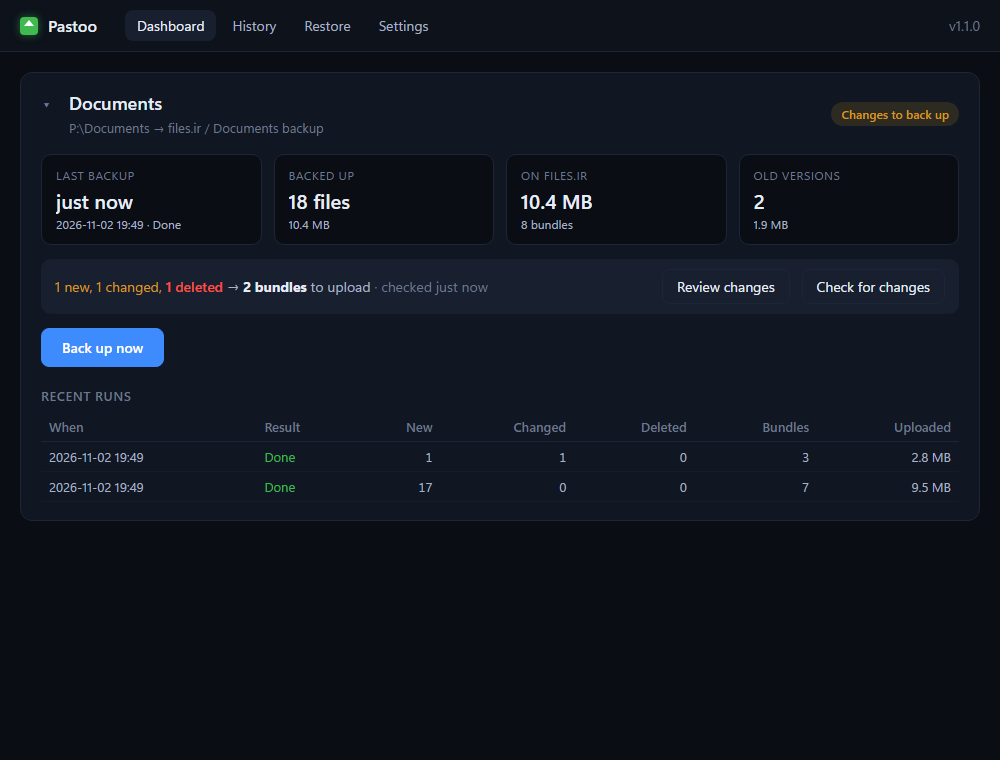
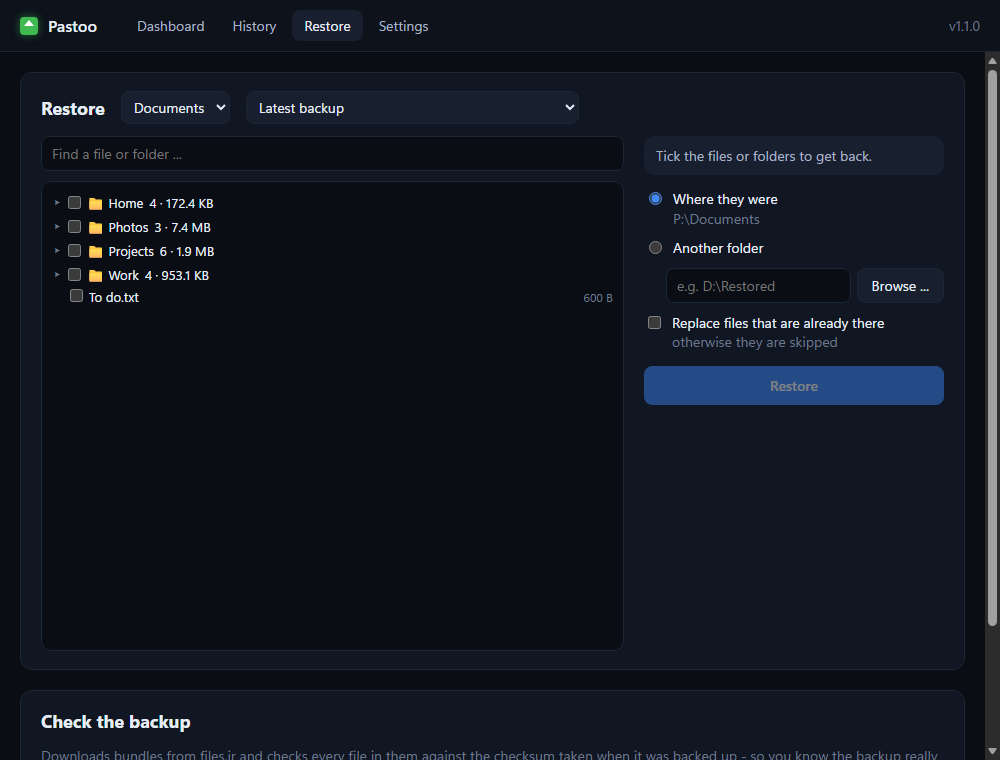
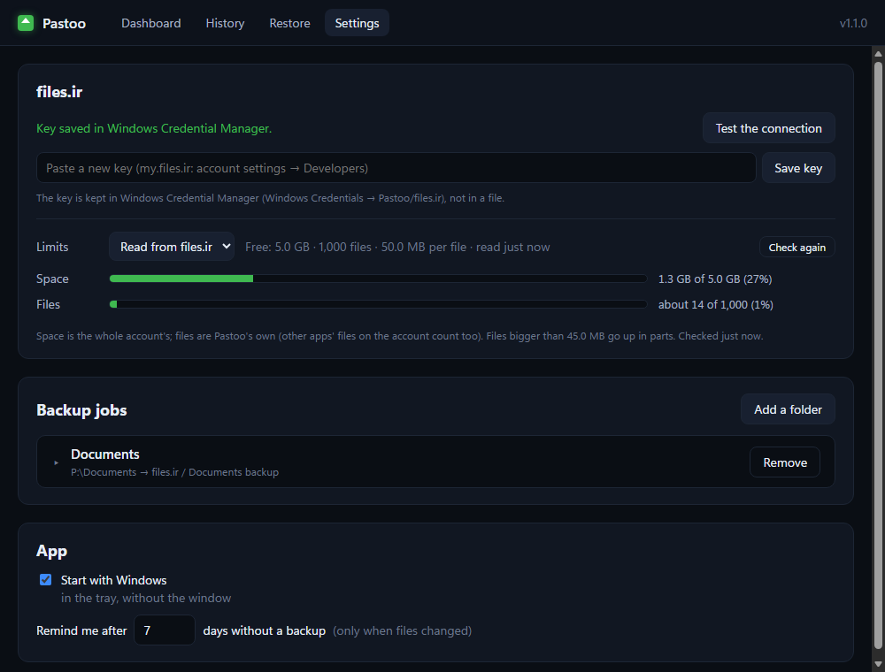

# Pastoo

**English** · [فارسی](README.fa.md)

Incremental backups of your folders to your own [files.ir](https://my.files.ir) account, for Windows.

*Pastoo* (پستو) is the old Persian word for the small back room of a house where the
valuables were kept.

The first backup uploads everything; after that only what changed goes up. Small files
travel in zip **bundles**, so a backup of thousands of files takes a few dozen uploads
instead of thousands. Replaced bundles are kept as old versions, and every file can be
restored - on this PC or on any other.

> Pastoo is an independent, unofficial program. It is not made by or affiliated with
> files.ir; it uses the files.ir developer API with your own API key.



## Features

- **Incremental** - each file's checksum is remembered; only the bundles whose files
  changed are uploaded again. Changes are seen even when a program puts the file's date
  back afterwards, as VeraCrypt does with its containers - nothing to set up.
- **Files in use are safe** - a file another program is writing to (a mounted VeraCrypt
  container, an open Outlook `.pst`) is never read half-written, and never counted as
  deleted: its last backed-up copy stays, and you are told to close it.
- **Bundles** - the files of a folder of up to 10 MB go up as one zip, big folders are
  split, and files of 5 MB or more go up on their own. Much faster than one upload per
  file, and easy on files.ir's servers.
- **Old versions** - a replaced bundle moves to `_versions`, kept for 5 versions and at
  least 30 days (both adjustable).
- **Preview** - see what is new, changed and deleted before a backup; deleted files are
  shown in red, and a backup that deletes files always shows the list first.
- **Restore** - tick files or folders from the latest backup or an old version, put them
  back where they were or into another folder.
- **Check the backup** - downloads bundles and compares every file with its checksum.
- **Several jobs** - each with its own folder, its folder on files.ir and skip rules,
  with a live count of what would be backed up.
- **files.ir plan aware** - reads your plan's limits (space, number of files, biggest
  upload) and shows how full the account is; files larger than one upload allows are
  sent in parts.
- **Tray icon** - green, yellow (no backup for a while), red (the last one failed) or
  blue (backing up); a reminder when there was no backup for some days and files changed.
- **No lock-in** - the bundles are ordinary zip files, and `_index.txt` lists which zip
  holds which file: without Pastoo, download a zip from the site and open it.
- Your key stays in Windows Credential Manager; nothing is sent anywhere but files.ir.



## Install

Download from [Releases](https://github.com/sadi754/pastoo/releases):

- **`Pastoo-Setup-<version>.exe`** - installs for your user only (no admin rights), into
  `%LOCALAPPDATA%\Programs\Pastoo`, with a Start menu entry and an uninstaller.
- **`Pastoo-<version>-win64.zip`** - portable: unzip anywhere and run `Pastoo\Pastoo.exe`.

Needs Windows 10 or 11, 64-bit, with the Edge WebView2 runtime (built into Windows 11).
The program isn't signed, so the first time Windows SmartScreen may say "Windows
protected your PC": **More info → Run anyway**.

## First start

1. On [my.files.ir](https://my.files.ir): account settings → **Developers** → make an API
   key (with the `files.*` permissions).
2. In Pastoo: **Settings → files.ir**, paste the key, **Save key**. It is checked with
   files.ir first.
3. **Settings → Backup jobs → Add a folder**: choose the folder, the name of its folder on
   files.ir, and what to skip (**+ Add common skips** adds the usual build and cache
   folders and temporary files). The numbers under the rules show what would be backed up.
4. **Dashboard → Back up now.**



## Using it

- **Tray icon** - left-click opens the window, right-click → **Back up now**.
- **Dashboard** - one card per job (click its title to fold it): the last backup, what is
  on files.ir, and what changed since; **Review changes** lists it file by file.
- **History** - every backup, and which files each one added, changed or deleted.
- **Restore** - from the latest backup or an old version. Files that are already there are
  skipped unless you tick *Replace*. **Check the backup** verifies 5 random bundles or all.
- **Settings** - jobs and skip rules, bundle size, how long old versions stay, the plan's
  limits (read from files.ir or set by hand), *Start with Windows*, the reminder.

Only one backup, restore or check runs at a time - also between the app and the command line.

## How it works

Every backup scans the job's folder and compares each file with what was uploaded last
time. Files are grouped into bundles by folder; a bundle whose files all stayed the same is
left alone, a changed one is uploaded as a new zip and the old zip moves to `_versions`. A
file deleted on the PC disappears from the next version of its bundle - the previous
version still has it.

**Seeing changes.** A file is read again (and its SHA-1 compared) when its size, its date
or its number in the NTFS change journal (USN) moved. The journal number moves on every
write and can't be put back, so a container whose date VeraCrypt restores is still seen.
Drives without a journal (FAT, exFAT, network drives) fall back to size and date, and every
file there is read again at least once a week.

**Files in use.** Files are read only while no other program is writing to them. A file
that is in use keeps its last backed-up copy; if other files of its bundle changed, that
bundle waits for the next backup. A file that is always open (the database of a program
that keeps running) is only backed up once it is closed. A VeraCrypt container is backed up
best while it is dismounted.

On files.ir, each job has its own folder:

```
<job's folder>/
  _backup.json          everything about the backup (files, bundles, versions) - with it,
                        another PC can continue or restore the backup
  _index.txt            every file and the bundle it is in (to read yourself)
  _changes/<date>.txt   what each backup changed (the newest 50; History in the app keeps all)
  _versions/<date>/     bundles replaced at that backup
  <folders>/...zip      the bundles; files of 5 MB or more go up on their own
  <name>.parts/         a file bigger than one upload allows (50 MB on the Free plan),
                        in parts part001, part002 ... - restoring joins them again
```

**files.ir plans.** Pastoo reads the account's plan at every start and after every
backup, so an upgrade is picked up by itself (the Free plan: 5 GB, 1,000 files, 50 MB per
file). From 70 % full every page shows a warning. Old copies of `_index.txt` and
`_backup.json` are deleted for good rather than left in the trash, since the trash counts
towards the space too.

**Not encrypted.** The bundles are plain zip files, readable by anyone with access to the
files.ir account - that is what makes them usable without Pastoo.

## Command line

`pastoo-cli.exe` (next to `Pastoo.exe`), e.g. for Task Scheduler:

```
pastoo-cli run [--job ID] [--dry-run]          back up (--dry-run: only show what changed)
pastoo-cli restore PATH... --to FOLDER [--overwrite] [--dry-run]
pastoo-cli history [--job ID]
pastoo-cli jobs
```

## Where things are

- `%LOCALAPPDATA%\Pastoo` - `settings.json` (jobs, options), `state.db` (what is on
  files.ir, the history), `backup.log` (every backup's lines), `app.log`.
- The files.ir key - Windows Credential Manager → Windows Credentials → `Pastoo/files.ir`.
- *Start with Windows* - `HKCU\Software\Microsoft\Windows\CurrentVersion\Run`, "Pastoo".

**Uninstall** from Windows Settings → Apps. It asks whether to delete the data in
`%LOCALAPPDATA%\Pastoo` too; your backups on files.ir stay either way. The key stays in
Credential Manager until you remove it there.

## Build from source

Python 3.10 or newer (developed on 3.12), Windows.

- `run.bat` - the app (makes a private `.venv` on its first run).
- `backup.bat` - one backup from the command line (the backup engine uses only Python's
  own library).
- `build.bat` - runs the tests, builds `dist\Pastoo\` and the zip (PyInstaller), and the
  installer when [Inno Setup 6](https://jrsoftware.org/isinfo.php) is installed.
- Tests: `python -m unittest discover -s tests`
- `PASTOO_INSTANCE=<suffix>` starts a separate copy (its own single-instance lock) to test a
  build next to the one in use; it leaves *Start with Windows* alone.

## License

[MIT](LICENSE)
